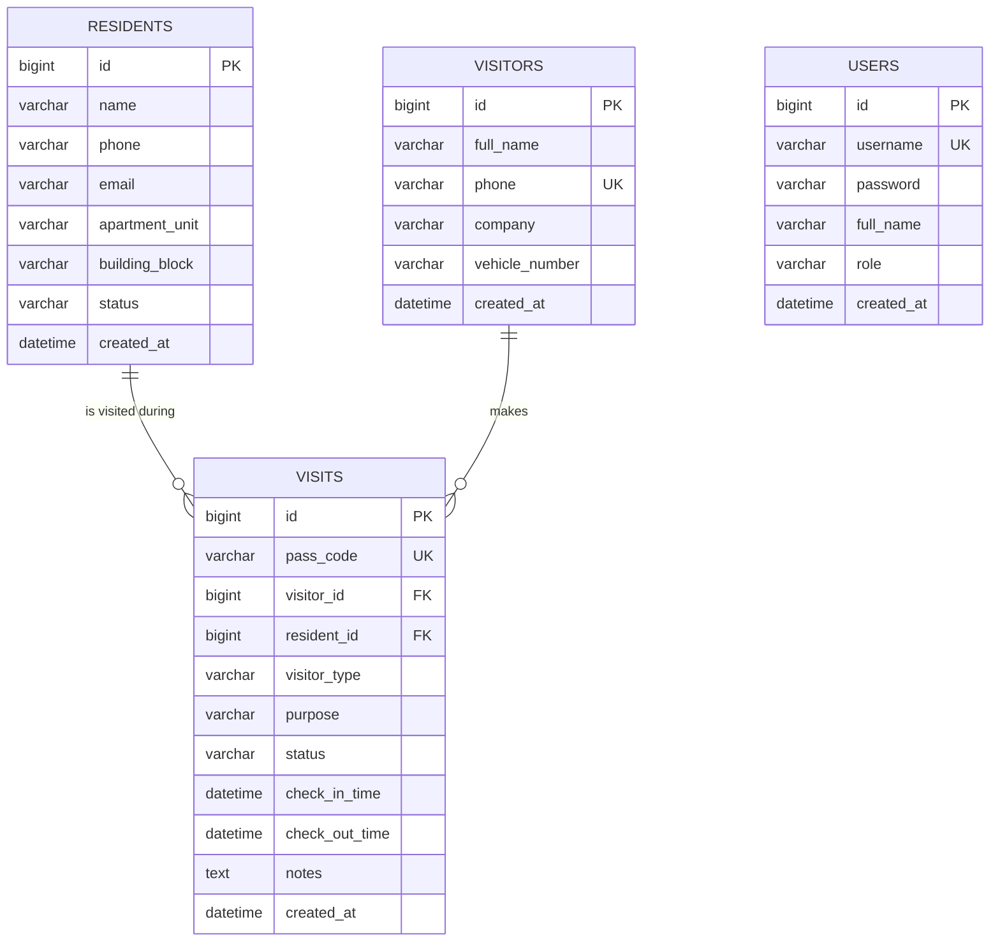

# 🏢 Smart Visitor Verification System

[](https://github.com/)
[](https://opensource.org/licenses/MIT)

> A modern, production-grade, and beginner-understandable web application for security guards to manage and verify visitors, guests, maintenance technicians, and delivery personnel entering residential complexes, gated communities, or corporate campuses.

---

## 📌 Table of Contents
1. [Project Overview](#-project-overview)
2. [Key Features](#-key-features)
3. [Architecture & Request Flow](#-architecture--request-flow)
4. [Database Design & Normalization](#-database-design--normalization)
5. [Technology Stack](#-technology-stack)
6. [Project Directory Structure](#-project-directory-structure)
7. [Getting Started (Step-by-Step)](#-getting-started-step-by-step)
8. [API Endpoints Reference & Postman](#-api-endpoints-reference--postman)
9. [Bootstrap 5 Classes Reference Guide](#-bootstrap-5-classes-reference-guide)
10. [Key Technical Interview Concepts](#-key-technical-interview-concepts)
11. [Recommended Git Commit History](#-recommended-git-commit-history)

---

## 🎯 1. Project Overview

### The Real-World Problem
Traditional security gates use physical paper registers. This introduces significant issues:
* **Gate Congestion**: Guards manually recording visitor names, phone numbers, and flat numbers slows down entry during peak hours.
* **Repetitive Delivery Work**: Delivery personnel (Amazon, Swiggy, Zomato, Dunzo) visit the property dozens of times daily, requiring tedious manual re-entry every single time.
* **Zero Real-Time Visibility**: Facility managers cannot answer *"Who is inside the campus right now?"* without manually parsing paper registers.
* **Security & Verification Risks**: Visitors often enter without verified destination residents.

### The Solution
The **Smart Visitor Verification System** equips security guards with an ultra-responsive web console that:
1. **Verifies destination residents** in real time before granting entry.
2. **Auto-populates returning visitor and courier details** as soon as a 10-digit phone number is entered.
3. **Enforces strict check-in / check-out state transitions** (preventing duplicate check-outs or ghost visits).
4. **Issues a printable/shareable Digital Visitor Pass** with a unique pass code.
5. **Provides a live occupancy dashboard** showing active visitors, total visits today, deliveries, and checked-out exits.

---

## ✨ 2. Key Features

* **🛡️ Security Guard Dashboard**: Live counters for *Currently Inside*, *Today's Visits*, *Today's Deliveries*, and *Checked Out Today*, plus a recent activity audit stream.
* **⚡ Delivery Fast-Track Workflow**: Instant phone-based profile lookup auto-fills names, vehicles, and courier agencies (Amazon, Swiggy, etc.), speeding up entry verification from 45 seconds to 5 seconds.
* **🔍 Real-Time Resident Autocomplete**: Search residents by name, apartment number (e.g. `A-101`), or building tower; blocks entry if a resident is inactive.
* **🎫 Digital Visitor Pass**: Generates a card complete with pass code (`VIS-2026-XXXX`), visitor identity, host details, timestamps, and print support.
* **🚪 1-Click Check-Out**: Real-time table of campus occupants with a single-click exit button that updates timestamps on the server.
* **📜 Multi-Filter Audit History**: Search historical visits by keyword, category (`REGULAR`, `DELIVERY`, `MAINTENANCE`, `GUEST`), visit status (`CHECKED_IN`, `CHECKED_OUT`), and date.
* **🔐 Guard Authentication**: Secure authentication using Spring Security, BCrypt password hashing, and stateless JWT tokens.

---

## 🏗️ 3. Architecture & Request Flow

We maintain a clean **Separation of Concerns** using a classical multi-tier architecture:

```text
[ Browser / React UI (Vite: Port 5173) ]
                 │
                 │ HTTP JSON REST Requests (Axios / Bearer Token)
                 ▼
[ Spring Boot Controller Layer (@RestController: Port 8080) ]
   - Validates incoming DTOs (@Valid, Bean Validation)
   - Dispatches requests to the service layer
   - Returns standardized HTTP response status codes
                 │
                 │ DTOs / Method Invocation
                 ▼
[ Spring Boot Service Layer (@Service) ]
   - Enforces business rules & state machine constraints
   - Manages transactions (@Transactional)
   - Generates unique digital pass codes
                 │
                 │ Domain Entities
                 ▼
[ Spring Data JPA Repository Layer (@Repository) ]
   - Spring Data JPA abstraction over Hibernate ORM
   - Executes JPQL queries and derived SQL
                 │
                 │ SQL (JDBC)
                 ▼
[ MySQL Relational Database (Port 3306) ]
   - Tables: users, residents, visitors, visits
```

---

## 🗄️ 4. Database Design & Normalization

### Why Separate `Visitor` from `Visit`? (Interview Highlight)
Storing visitor identity and check-in times in a single table causes **data redundancy** and **update anomalies** whenever repeat delivery drivers visit the property.

By normalizing into **3NF (Third Normal Form)**:
* **`Visitor`**: Represents the **Person / Identity** (Name, Phone [Unique], Company, Vehicle).
* **`Visit`**: Represents an **Event / Session** (Pass Code, Foreign Key to Visitor, Foreign Key to Resident, Type, Status, Check-In/Out Timestamps).



---

## 💻 5. Technology Stack

### Frontend
* **React 18** (JavaScript JSX, Hooks: `useState`, `useEffect`)
* **React Router DOM 6** (Client-side routing without page reloads)
* **Bootstrap 5.3 & Bootstrap Icons** (Responsive layouts, card components, modals)
* **Axios** (Centralized API client with JWT interceptors)
* **Vite** (Ultra-fast build and development server)

### Backend
* **Java 17**
* **Spring Boot 3.2.5**
* **Spring Web** (REST API development, Jackson JSON serialization)
* **Spring Data JPA & Hibernate** (ORM, automated query generation)
* **Bean Validation** (Hibernate Validator: `@NotBlank`, `@Pattern`, `@NotNull`)
* **Spring Security & JJWT** (Stateless authentication, BCrypt password hashing)
* **Maven** (Dependency and build management)

### Database
* **MySQL 8.0+** (Relational storage with foreign key constraints and indexes)

---

## 📂 6. Project Directory Structure

```text
smart-visitor-system/
│
├── backend/
│   ├── src/main/java/com/example/visitor/
│   │   ├── SmartVisitorApplication.java
│   │   ├── config/             # Security, JWT, CORS, DataInitializer
│   │   ├── controller/         # REST Controllers (Auth, Resident, Visitor, Visit, Dashboard)
│   │   ├── dto/                # Request & Response Data Transfer Objects
│   │   ├── entity/             # JPA Entities (User, Resident, Visitor, Visit, Enums)
│   │   ├── exception/          # Custom exceptions & GlobalExceptionHandler
│   │   ├── repository/         # Spring Data JPA Repositories
│   │   └── service/            # Core business rules & state management
│   ├── src/main/resources/
│   │   ├── application.properties
│   │   └── schema.sql          # Standalone DDL for MySQL Workbench
│   ├── src/test/java/          # Unit tests (VisitServiceTest)
│   └── pom.xml
│
├── frontend/
│   ├── src/
│   │   ├── api/                # Axios client & service modules
│   │   ├── components/
│   │   │   ├── common/         # Navbar, StatusBadge, LoadingSpinner, AlertMessage, SearchBar
│   │   │   ├── dashboard/      # StatCard
│   │   │   └── visitors/       # DigitalVisitorPass, ResidentSelect
│   │   ├── pages/              # Dashboard, Register, Current, History, Details, Residents, Login
│   │   ├── App.jsx             # React Router routing
│   │   ├── main.jsx            # Entry point with Bootstrap imports
│   │   └── index.css
│   ├── index.html
│   ├── vite.config.js
│   └── package.json
│
├── postman/
│   └── Smart_Visitor_Verification_System.postman_collection.json
└── README.md
```

---

## 🚀 7. Getting Started (Step-by-Step)

### Prerequisites
* **Java Development Kit (JDK 17 or higher)**
* **Node.js (v18 or higher) and npm**
* **MySQL Server (v8.0 or higher)**

---

### Step 1: Database Setup in MySQL

1. Open **MySQL Workbench** or your MySQL CLI and create the database:
   ```sql
   CREATE DATABASE smart_visitor_db;
   ```
2. Verify or update the credentials in `backend/src/main/resources/application.properties`:
   ```properties
   spring.datasource.url=jdbc:mysql://localhost:3306/smart_visitor_db?createDatabaseIfNotExist=true&useSSL=false&serverTimezone=UTC&allowPublicKeyRetrieval=true
   spring.datasource.username=root
   spring.datasource.password=root
   ```
   *(Hibernate will automatically create all tables on first startup via `spring.jpa.hibernate.ddl-auto=update`)*.

---

### Step 2: Run the Spring Boot Backend

Open a terminal in the `backend/` directory:

```bash
cd backend
# Using Maven wrapper or installed maven:
mvn spring-boot:run
```

The backend starts at: **`http://localhost:8080`**  
The API base is available at: **`http://localhost:8080/api`**

> **💡 Automatic Starter Seed Data**:  
> On first startup, `DataInitializer.java` automatically seeds:
> * 1 Security Guard user (`guard` / `guard123`)
> * 6 Sample Residents across Tower A, B, C, D
> * 4 Returning delivery drivers & visitors (Amazon, Swiggy, Urban Company, Guest)
> * Active and completed visits to populate your dashboard immediately!

---

### Step 3: Run the React Frontend

Open a second terminal in the `frontend/` directory:

```bash
cd frontend
npm install
npm run dev
```

Open your browser at: **`http://localhost:5173`**

### Default Security Guard Login
* **Username**: `guard`
* **Password**: `guard123`

---

## 📡 8. API Endpoints Reference & Postman

A complete Postman collection is included in [`postman/Smart_Visitor_Verification_System.postman_collection.json`](file:///e:/PGTBR/Projects/SMART%20VISITER%20VERIFICATION%20SYSTEM/postman/Smart_Visitor_Verification_System.postman_collection.json).

| Category | Method | Endpoint | Request Body | Description |
| :--- | :--- | :--- | :--- | :--- |
| **Auth** | `POST` | `/api/auth/login` | `{ "username": "guard", "password": "guard123" }` | Authenticates guard, returns JWT token |
| **Dashboard** | `GET` | `/api/dashboard/stats` | None | Returns counters & top recent gate visits |
| **Residents** | `GET` | `/api/residents` | None | Lists all residents |
| | `GET` | `/api/residents/search?query=Rahul` | None | Autocomplete search by name/apartment |
| | `POST` | `/api/residents` | `{ "name": "...", "phone": "...", "apartmentUnit": "A-101", "buildingBlock": "Tower A" }` | Registers a new resident |
| **Visitors** | `GET` | `/api/visitors/search?phone=9123456780` | None | Instant lookup for returning visitors |
| **Visits** | `POST` | `/api/visits` | `{ "visitorName": "...", "phone": "...", "residentId": 1, "visitorType": "DELIVERY", "purpose": "..." }` | Checks in visitor & generates pass |
| | `GET` | `/api/visits/current` | None | Lists all visitors currently inside |
| | `GET` | `/api/visits/history` | Query params: `?type=&status=&date=&query=` | Searchable audit history |
| | `GET` | `/api/visits/{id}` | None | Retrieves single visit & pass details |
| | `PATCH` | `/api/visits/{id}/check-out` | None | Checks out visitor & records timestamp |

---

## 🎨 9. Bootstrap 5 Classes Reference Guide

Per project specifications, here is the reference breakdown of Bootstrap 5 classes used in the project:

| Class Name | Function / Purpose | Official Bootstrap Docs Section |
| :--- | :--- | :--- |
| `container-fluid` | Full-width container spanning 100% of the viewport width | *Layout &rarr; Containers* |
| `row`, `col-12`, `col-md-6`, `col-lg-3` | Responsive 12-column flexbox grid system | *Layout &rarr; Grid* |
| `g-2`, `g-3`, `g-4` | Gutters utility adding horizontal and vertical gaps between grid columns | *Layout &rarr; Gutters* |
| `card`, `card-header`, `card-body` | Flexible content box with header, body, and borders | *Components &rarr; Card* |
| `table`, `table-hover` | Tabular data formatting with subtle hover highlighting | *Content &rarr; Tables* |
| `badge`, `rounded-pill` | Small indicator tag formatted as a rounded pill | *Components &rarr; Badges* |
| `alert`, `alert-danger`, `alert-success` | Contextual dismissible notification banner | *Components &rarr; Alerts* |
| `input-group`, `input-group-text` | Combines text inputs with icons or buttons into a continuous component | *Forms &rarr; Input group* |
| `form-control`, `form-select` | Form inputs and dropdown selects with Bootstrap focus borders | *Forms &rarr; Form controls* |
| `is-invalid`, `invalid-feedback` | Displays red error borders and contextual error messages | *Forms &rarr; Validation* |
| `spinner-border`, `spinner-border-sm` | CSS-based animated circular loading spinner | *Components &rarr; Spinners* |
| `btn`, `btn-primary`, `btn-outline-secondary` | Styled clickable action buttons | *Components &rarr; Buttons* |
| `btn-group`, `btn-group-sm` | Combines a series of buttons into a single horizontal bar | *Components &rarr; Button group* |
| `d-flex`, `justify-content-between`, `align-items-center` | Flexbox alignment and spacing utilities | *Utilities &rarr; Flex* |
| `shadow-sm`, `shadow-lg` | Box-shadow depth elevation utilities | *Utilities &rarr; Shadow* |
| `border-0`, `border-start`, `border-4` | Border manipulation utilities | *Utilities &rarr; Borders* |
| `text-uppercase`, `fw-bold`, `fs-4` | Typography transformations, font weights, and sizes | *Utilities &rarr; Text* |

---

## 🎓 10. Key Technical Interview Concepts

### 1. What is the difference between `@RestController` and `@Controller`?
* `@Controller` is the traditional Spring MVC annotation used to return HTML views (e.g. via Thymeleaf or JSP).
* `@RestController` is a convenience annotation combining `@Controller` and `@ResponseBody`. It tells Spring that all handler methods return data serialized directly into JSON or XML via Jackson HTTP message converters.

### 2. Why use DTOs instead of exposing JPA Entities directly?
1. **Security (Mass Assignment)**: A malicious user could send `{ "status": "CHECKED_OUT" }` or `{ "id": 999 }` in a registration request. DTOs restrict incoming payloads strictly to permitted input fields.
2. **Decoupling**: The internal database schema can evolve without breaking public API contracts with mobile apps or frontend web clients.
3. **Preventing Circular References**: Bi-directional JPA associations can cause Jackson to enter an infinite loop when generating JSON.

### 3. What is the difference between JPA and Hibernate?
* **JPA (Jakarta Persistence API)** is the *interface / standard specification* that defines annotations like `@Entity`, `@Id`, `@OneToMany`.
* **Hibernate** is the *underlying implementation engine* that generates the actual vendor-specific SQL queries (e.g. MySQL dialect) under the hood.

### 4. How does Inversion of Control (IoC) and Dependency Injection (DI) work in Spring?
In traditional Java, a class constructs its dependencies manually: `private VisitRepository repo = new VisitRepositoryImpl()`.  
With Spring IoC, the Spring ApplicationContext creates and manages all singleton beans. When `VisitService` declares `public VisitService(VisitRepository repo)`, Spring automatically injects the initialized instance at startup. This enables easy unit testing with mocks (e.g. Mockito).

### 5. Why is CORS needed and how does it work?
**Cross-Origin Resource Sharing (CORS)** is a security policy enforced by modern web browsers. When JavaScript running on `http://localhost:5173` attempts to fetch data from `http://localhost:8080`, the browser blocks the response because the origins (ports) differ. The Spring Boot backend must explicitly reply with `Access-Control-Allow-Origin: http://localhost:5173` to grant permission.

### 6. How does the Visit State Machine protect system integrity?
The service layer verifies that:
* Only visits with `status == CHECKED_IN` can transition to `CHECKED_OUT`.
* Attempting to check out an already checked-out visitor throws `InvalidStateTransitionException` (`HTTP 400 Bad Request`), preventing duplicate exit records and incorrect dwell times.

---

## 📝 11. Recommended Git Commit History

When pushing this project to your GitHub portfolio, use these clean, professional commit stages:

```bash
git init
git commit -m "Initial commit: project structure and specifications"
git commit -m "feat(backend): configure Maven dependencies, application properties, and MySQL schema"
git commit -m "feat(entity): add JPA entities for User, Resident, Visitor, and Visit"
git commit -m "feat(repository): add Spring Data JPA repositories with JPQL search filters"
git commit -m "feat(dto): add request/response DTOs and Bean Validation rules"
git commit -m "feat(service): implement business logic, state transitions, and pass code generator"
git commit -m "feat(api): implement REST controllers and centralized exception handling"
git commit -m "feat(security): configure Spring Security, BCrypt, and stateless JWT authentication"
git commit -m "test(backend): add unit tests for VisitService business rules"
git commit -m "feat(frontend): initialize React 18 with Vite, React Router, and Axios client"
git commit -m "feat(ui): add responsive Navbar, StatusBadge, StatCard, and DigitalVisitorPass"
git commit -m "feat(pages): build Dashboard, Visitor Registration, and Resident autocomplete"
git commit -m "feat(pages): build Current Visitors live console with 1-click check-out"
git commit -m "feat(pages): build Visitor History with multi-criteria filtering and pagination"
git commit -m "docs: add comprehensive README with architectural documentation and interview guide"
```

---

## 👨‍💻 Developer & Portfolio Attribution
* **Project**: Smart Visitor Verification System
* **Primary Technologies**: React 18, Spring Boot 3, MySQL 8, Bootstrap 5
* **Author**: Full-Stack Software Engineer
